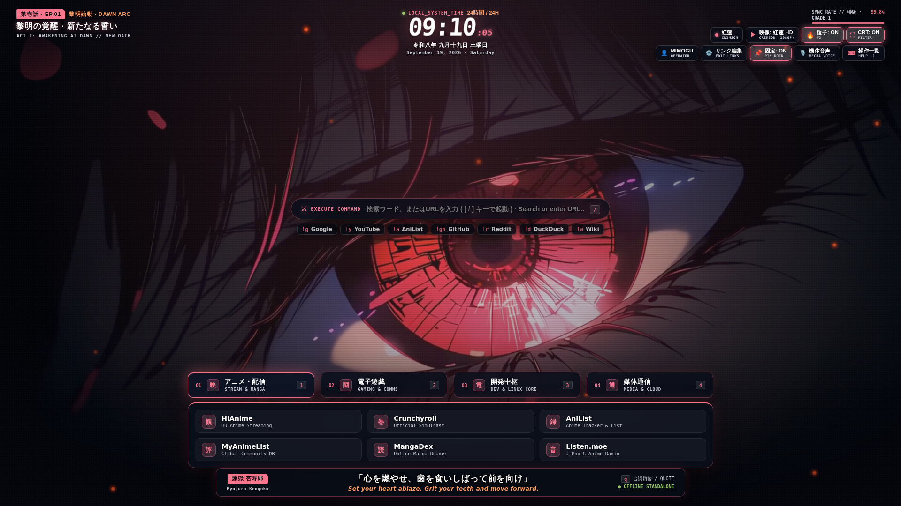
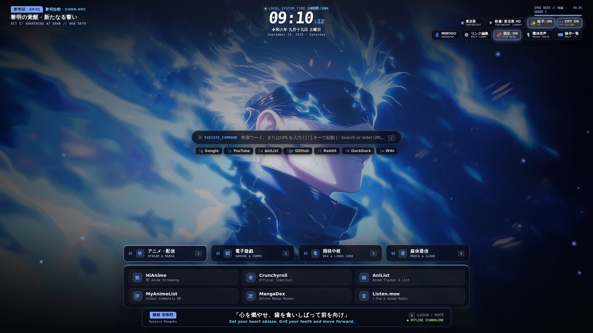
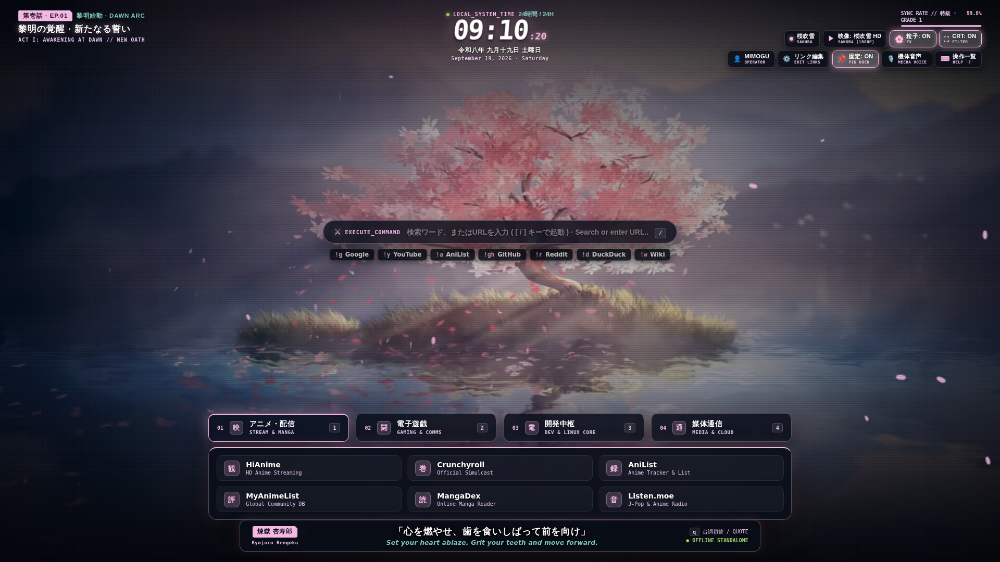
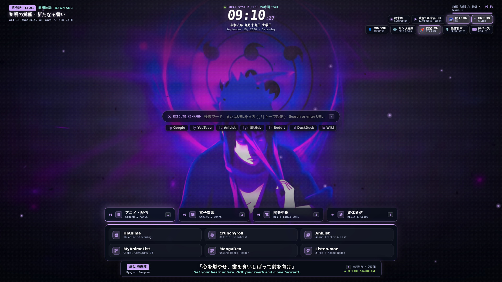
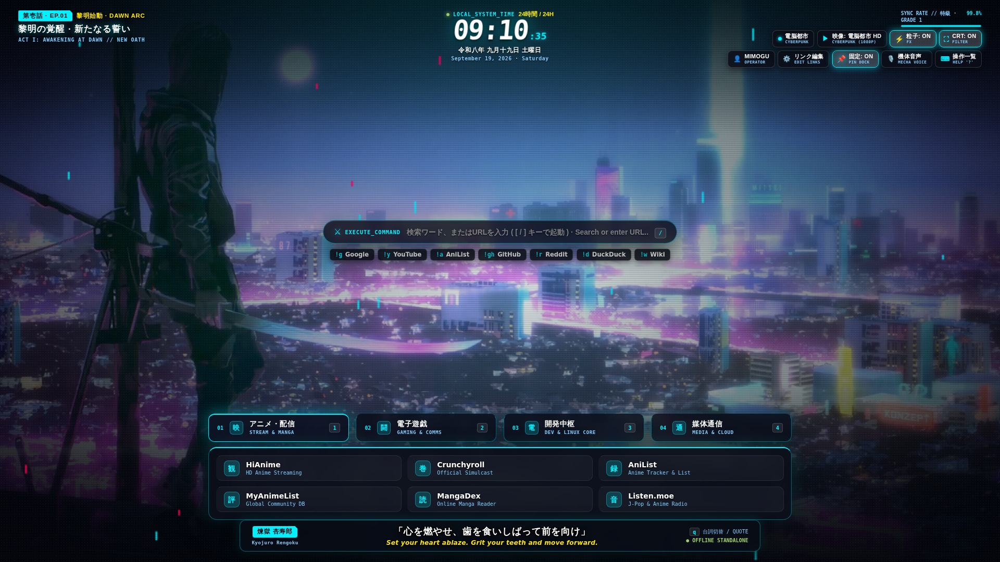

<div align="center">


**【 領域展開 · DOMAIN EXPANSION FOR YOUR BROWSER 】**<br/>
<sub>Every blank new tab becomes the opening scene of your own anime — live video stages, falling sakura, a mecha voice that greets you by name, and a cockpit full of your bookmarks.</sub>

<br/>

[](#第陸話--結界--offline--privacy)
[](#第拾話--機体構造--architecture)
[](#第漆話--全端末対応--every-device)
[](#第壱話--起動--installation)
[](#第陸話--結界--offline--privacy)

<a href="https://mimogu.github.io/SHINSEKAI-Startup-Page/">
  
</a>

<br/><br/>



</div>

<br/>

> ### 「心を燃やせ、歯を食いしばって前を向け」
> **煉獄 杏寿郎** · *Kyojuro Rengoku* — "Set your heart ablaze. Grit your teeth and move forward."

---

## 📺 放送リスト · Episode Guide

| 話数 | Episode | What's inside |
|:---:|:---|:---|
| 第壱話 | [起動 · Installation](#第壱話--起動--installation) | Chrome/Brave/Edge new tab, Firefox, phone home screen, self-hosting |
| 第弐話 | [機能 · Abilities](#第弐話--機能--abilities) | Every module of the cockpit |
| 第参話 | [陣営 · Factions](#第参話--陣営--factions--themes) | Five themes + the custom Spectrum Tuner |
| 第肆話 | [操作 · Controls](#第肆話--操作--keyboard-controls) | Full keyboard map |
| 第伍話 | [検索 · Katana Console](#第伍話--検索--katana-console) | Search, quick launch, bangs, URLs |
| 第陸話 | [結界 · Offline & Privacy](#第陸話--結界--offline--privacy) | What touches the network (almost nothing) |
| 第漆話 | [全端末 · Every Device](#第漆話--全端末対応--every-device) | Phones, tablets, touch, notches, 4K |
| 第捌話 | [改造 · Customization](#第捌話--改造--customization) | Name, links, icons, wallpapers, voice, backups |
| 第玖話 | [秘術 · URL Parameters](#第玖話--秘術--url-parameters) | Boot straight into any configuration |
| 第拾話 | [機体構造 · Architecture](#第拾話--機体構造--architecture) | Performance engine and file map |
| 最終話 | [次回予告 · Next Episode](#最終話--次回予告--next-episode) | Credits & contributing |

---

## 第壱話 · 起動 · Installation

> *「問おう、貴方が私のマスターか」* — **Saber** · "I ask of you: are you my Master?"

### ⚔️ A. Chromium New Tab — Chrome · Brave · Edge · Opera · Vivaldi

The repo is a ready-made Manifest V3 extension. No store, no account:

```bash
git clone https://github.com/Mimogu/SHINSEKAI-Startup-Page.git
```

1. Open `chrome://extensions` (or `brave://extensions`, `edge://extensions`).
2. Turn on **Developer mode** (top right).
3. **Load unpacked** → pick the cloned `SHINSEKAI-Startup-Page` folder.
4. Press <kbd>Ctrl</kbd>+<kbd>T</kbd>. 起動完了.

> [!NOTE]
> Extension pages enforce a strict Content-Security-Policy: **no inline `<script>` and no `onclick=`/`onerror=` attributes**. All boot logic lives in `theme-core.js`, `boot.js` and `boot-stage.js` for that reason — keep it that way when editing `index.html`.

### 🦊 B. Firefox

- **New tab:** install [New Tab Override](https://addons.mozilla.org/firefox/addon/new-tab-override/) → *Local file* → choose `index.html`.
- **Home page:** *Settings → Home → Custom URLs* → `file:///home/YOU/SHINSEKAI-Startup-Page/index.html` (Windows: `file:///C:/Users/YOU/…/index.html`).

### 📱 C. Phone, tablet or desktop app (PWA)

Open the [live site](https://mimogu.github.io/SHINSEKAI-Startup-Page/) once while online, then:

- **Android / Chrome / Edge:** menu → **Install app** / **Add to Home screen**.
- **iPhone / iPad (Safari):** Share → **Add to Home Screen**.

It launches full-screen with its own 新 icon and keeps working **offline** (see 第陸話).

### 🏯 D. Your own copy on GitHub Pages

Fork → *Settings → Pages* → deploy from `main` / root. Any static host works (Netlify, Cloudflare Pages, nginx, `python3 -m http.server`). There is no build step.

---

## 第弐話 · 機能 · Abilities

> *「大丈夫、僕 最強だから」* — **Gojo Satoru** · "Don't worry. After all, I'm the strongest."

<table>
<tr>
<td width="50%" valign="top">

### 🎬 映像舞台 · Wallpaper Engine
- **動的 Live** — five looping anime stages, 720p by default, **1080p Ultra** with one click.
- **静止画 Static** — the same five scenes as 1080p WebP stills (zero video decoding).
- **カスタム Custom** — upload many MP4 / WebM / PNG / JPG / WebP / GIF files at once (35 MB each, stored in IndexedDB), or add web URLs.
- **省電力 Eco** — no video at all.
- Delete any default and bring it back with *Restore* or by re-uploading a file with the same name.

</td>
<td width="50%" valign="top">

### 🌸 粒子演出 · Particle FX
- **紅蓮** rising embers · **桜吹雪** spinning petals · **電脳都市** neon rain · **東京夜 / 終末谷** spirit orbs · **カスタム** orbs in your colour.
- Rendered at half resolution, capped at 60 FPS, and **fully stopped** when off (<kbd>b</kbd>), hidden, or a dialog is open.

</td>
</tr>
<tr>
<td valign="top">

### ⚔️ 話数表示 · Episode HUD
- The title card changes with the time of day: 第壱話 *dawn*, 第拾弐話 *duel*, 第廿四話 *climax*, 終章 *standby*.
- Clock with Japanese era date (令和八年 十一月七日 土曜日), 12/24 h toggle (<kbd>c</kbd>).

</td>
<td valign="top">

### 💬 字幕 · Subtitle Bar
- 20 legendary lines (Rengoku, Gojo, Sukuna, Naruto, Levi, Lelouch, Luffy, Zoro, Kamina, Saber, Archer, Edward Elric…) in Japanese + English.
- Starts on a random quote every tab; click or <kbd>q</kbd> to cycle.

</td>
</tr>
<tr>
<td valign="top">

### ⏳ 忍修練 · Shinobi Focus Timer
- 25-minute focus / 5-minute cooldown (<kbd>x</kbd>). **Double-click or right-click** it to set 1–180 / 1–60 minutes.
- **Survives new tabs and reloads** and stays in sync across every open tab; exactly one tab rings at the end.
- Optional **desktop notification** when a phase ends while you're elsewhere.
- Shows the countdown in the tab title: `[12:34] shinsekai`.

</td>
<td valign="top">

### 🎙️ 機体音声 · Mecha Voice & Synth SFX
- *「ようこそ、ミモグ様。新世界システム、起動完了しました」* plays when the boot finishes (<kbd>v</kbd> to replay).
- Boot animation **FULL / 1 per hour / OFF** and voice **ON / OFF** in the Operator hub.
- Procedural Web Audio chirps, blade sweeps and chimes — no sound files — toggle with <kbd>m</kbd>.

</td>
</tr>
<tr>
<td valign="top">

### 🗡️ 刀剣格納庫 · Blade Launcher
- Four bookmark sectors (01 アニメ · 02 電子遊戯 · 03 開発中枢 · 04 媒体通信), opened by hover, tap or <kbd>1</kbd>–<kbd>4</kbd>; pin it open with <kbd>p</kbd>.
- Real logos for the default sites ship **inside the repo**; anything else shows its kanji seal 封印 or an icon you upload.

</td>
<td valign="top">

### 📺 走査線 · CRT & Film Grain
- Retro scanlines + grain in a single composited layer (<kbd>g</kbd>).
- Kiroshi-style target brackets and chamfered mecha frames on the HUD.

</td>
</tr>
</table>

---

## 第参話 · 陣営 · Factions & Themes

> *「お前が信じる、お前を信じろ！」* — **Kamina** · "Believe in the you who believes in yourself!"

Switch with <kbd>t</kbd> or the faction button. A default wallpaper follows the faction; your own custom wallpaper or Eco mode is never replaced.

<div align="center">
<table>
  <tr>
    <td width="50%" align="center"><br/><b>🔥 紅蓮 · Crimson Flame</b><br/><sub>煉獄炎獄 · rising embers · <code>#f7768e</code></sub></td>
    <td width="50%" align="center"><br/><b>🌌 東京夜 · TokyoNight Void</b><br/><sub>無量空処 · spirit orbs · <code>#7aa2f7</code></sub></td>
  </tr>
  <tr>
    <td width="50%" align="center"><br/><b>🌸 桜吹雪 · Sakura Ronin</b><br/><sub>侍刀一閃 · falling petals · <code>#f4b8e4</code></sub></td>
    <td width="50%" align="center"><br/><b>🌀 終末谷 · Catppuccin Spiral</b><br/><sub>宿命螺旋 · chakra spheres · <code>#cba6f7</code></sub></td>
  </tr>
  <tr>
    <td colspan="2" align="center"><br/><b>⚡ 電脳都市 · Cyberpunk Neon</b><br/><sub>超限界 · digital rain · <code>#00f0ff</code></sub></td>
  </tr>
</table>
</div>

### 🎛️ 調色中枢 · Custom Spectrum Tuner

Your own faction colour, applied live to every border, glow and particle:

| 霊力結晶 Chakra Core | Colour | | 霊力結晶 Chakra Core | Colour |
|:---|:---:|:---:|:---|:---:|
| ⚡ 雷光・神速 Amber Gold | `#fbbf24` | | 🌸 幽玄・紅桜 Rose Pink | `#f43f5e` |
| 🍃 風神・翠緑 Emerald | `#10b981` | | 🔥 日輪・業火 Sunset Orange | `#fb923c` |
| 🌊 碧羅・蒼波 Ocean Cyan | `#06b6d4` | | ❄️ 氷華・零度 Sky Blue | `#38bdf8` |
| 🔮 虚式・紫電 Lavender | `#c084fc` | | ☣️ 毒蝶・幻紫 Magenta | `#d946ef` |
| 🩸 真紅・終焉 Crimson | `#ff3366` | | 🌌 星骸・白金 Platinum | `#e2e8f0` |

Plus a 0–360° **hue resonator**, a 2-D **saturation/value pad**, **HEX** and **R/G/B** inputs, and a screen **eyedropper** (⌖). Too-dark or washed-out picks are automatically lifted to a readable accent, so the UI never disappears.

---

## 第肆話 · 操作 · Keyboard Controls

> *「悔いなき選択を自分で選べ」* — **Levi Ackerman** · "Make the choice you'll regret the least."

| Key | 技 Technique | Effect |
|:---:|:---|:---|
| <kbd>/</kbd> | 刀 Katana Console | Focus search |
| <kbd>t</kbd> | 陣営 Cycle Faction | Crimson → TokyoNight → Sakura → Catppuccin → Cyberpunk → Custom |
| <kbd>s</kbd> / <kbd>w</kbd> | 舞台 Cycle Wallpaper | Next live / static scene |
| <kbd>1</kbd>–<kbd>4</kbd> | 展開 Deploy Sector | Open a bookmark sector |
| <kbd>p</kbd> | 固定 Pin Dock | Keep the bookmark drawer open |
| <kbd>e</kbd> | 構成 Link Editor | Edit bookmarks, icons, import / export |
| <kbd>u</kbd> / <kbd>o</kbd> | 操縦士 Operator Hub | Name, honorific, performance tier, boot, voice, search engine |
| <kbd>x</kbd> | 修練 Focus Timer | Start / pause / end break |
| <kbd>b</kbd> / <kbd>a</kbd> | 粒子 Particles | Toggle particle FX |
| <kbd>g</kbd> | 走査線 CRT | Toggle scanlines & grain |
| <kbd>c</kbd> | 時計 Clock | 12 h / 24 h |
| <kbd>m</kbd> | 音響 Synth SFX | Toggle UI sounds |
| <kbd>v</kbd> | 音声 Voice | Replay the greeting |
| <kbd>q</kbd> | 台詞 Quote | Next subtitle |
| <kbd>?</kbd> | 一覧 Help | Keybinding sheet |
| <kbd>Esc</kbd> | 解除 Disengage | Close popups / dialogs, leave the search box |

Hotkeys never fire while you're typing or while a dialog is open, and never steal browser shortcuts (<kbd>Ctrl</kbd>/<kbd>Alt</kbd>/<kbd>⌘</kbd> combos, Japanese IME input).

---

## 第伍話 · 検索 · Katana Console

> *「撃っていいのは、撃たれる覚悟のある奴だけだ」* — **Lelouch** · "The only ones who should shoot are those prepared to be shot."

**瞬間移動 · Quick launch.** Start typing a pinned link's name — `crunch`, `git`, `arch` — and matching bookmarks appear under the search bar. <kbd>↑</kbd>/<kbd>↓</kbd> to choose, <kbd>Enter</kbd> to jump. When what you typed is the start of a link's name it's pre-selected; <kbd>Shift</kbd>+<kbd>Enter</kbd> always searches the web instead.

| Type | Goes to |
|:---|:---|
| `anything else` | Your default engine — **Google, DuckDuckGo, Brave or Startpage** (Operator hub → 検索機関) |
| `!g` `!y` `!gh` `!r` `!d` `!w` + words | Google · YouTube · GitHub · Reddit · DuckDuckGo · Wikipedia |
| `!aur yay`, `!mdn grid`, `!npm vite` … | Any of DuckDuckGo's ~13,000 [bangs](https://duckduckgo.com/bangs) |
| `github.com`, `https://…`, `localhost:3000`, `192.168.1.1/admin`, `mailto:a@b.jp` | Opened directly |
| `3.14`, `node.js` | Searched (things that merely contain a dot aren't treated as sites) |
| `:user NAME`, `:settings` | Rename the pilot / open the Operator hub |

---

## 第陸話 · 結界 · Offline & Privacy

> *「失礼だな、純愛だよ」* — **Okkotsu Yuta** · "How rude. This is pure love."

**The page itself makes zero third-party requests.** No CDN, no analytics, no Google Fonts, no favicon service:

| Piece | Where it comes from |
|:---|:---|
| Fonts (Zen Kaku Gothic New, JetBrains Mono, Plus Jakarta Sans) | `assets/fonts/` — subsetted WOFF2, ~280 KB. A JIS level-1 kanji pack only downloads if you type a kanji the UI doesn't already use. |
| Bookmark logos | `assets/icons/` (bundled) or an image you upload — stored inline with the link. |
| Wallpapers, stills, voice, app icons | `assets/` |
| Your settings, links, focus timer | `localStorage`; uploaded wallpapers in IndexedDB. Never leaves the browser. |

**The 結界 barrier (service worker).** When served over http(s) (GitHub Pages, any static host), `sw.js` precaches the whole app, so it opens with no connection. Wallpaper videos are cached the first time they play online and then loop offline too (with proper byte-range support). A video that was never cached falls back to its still image for that session only — your saved choice is untouched. The extension and `file://` installs are local already and don't use it.

Only two things ever go online, and only because you asked: **the search you submit** and **web-URL wallpapers** you add yourself.

Upgrading from an older version? Icons it had cached from Google / icon.horse are moved into your links automatically, then the old cache keys are deleted.

---

## 第漆話 · 全端末対応 · Every Device

> *「立って歩け、前へ進め」* — **Edward Elric** · "Stand up and walk. Keep moving forward."

| Device | How the cockpit adapts |
|:---|:---|
| 🖥️ Desktop / laptop | The classic single-screen cockpit; the bookmark drawer opens on hover. |
| 📺 4K monitors & TVs | Everything scales up proportionally (2200 px+ and 3000 px+ steps), so the HUD isn't a speck in the middle. |
| 📱 Phones (portrait & landscape) | The layout stacks and the page scrolls; dialogs become full-width and scroll as one page; the subtitle bar stacks; 16 px inputs stop iOS from zooming in. |
| 👆 Touch screens & tablets | 44 px tap targets, keyboard-hint badges hidden, the drawer opens on tap and closes when you tap elsewhere. |
| 🔲 Notches & rounded corners | `viewport-fit=cover` + safe-area padding. |
| 🐢 Slow / low-power hardware | Auto performance tier (HIGH / MID / ECO) and an FPS watchdog that drops costly blur when frames dip. |
| ♿ Accessibility | `prefers-reduced-motion`, visible keyboard focus rings, forced-colours mode, ARIA roles on the search box and its suggestion list. |

---

## 第捌話 · 改造 · Customization

> *「人は心が原動力だから、心はどこまでも強くなれる」* — **Kamado Tanjiro**

<details open>
<summary><b>👤 操縦士 · Operator identity</b> — <kbd>u</kbd></summary>

- Callsign (e.g. `LEVI`, `ZERO`) and honorific: `-SAMA`, `-SAN`, `-SENPAI`, `-KUN`, none, or your own (`殿`, `-COMMANDER`…).
- **機体性能 Performance tier:** HIGH (30 particles, 16 px blur) · MID (18, 8 px) · ECO (no particles, no blur) · 🔄 auto-detect.
- **起動演出 Boot:** FULL every tab · **1 / HOUR** (then instant) · OFF — and the voice greeting ON / OFF.
- **検索機関 Search engine:** Google · DuckDuckGo · Brave · Startpage.
- ▶ **Test boot** to watch the sequence with your name.

</details>

<details>
<summary><b>🔗 構成中枢 · Links & icons</b> — <kbd>e</kbd></summary>

- Add, edit, delete links per sector, each with a 1–2 character kanji seal (観 遊 網 音…).
- **Click the seal box to upload any image as the link's icon.** It's shrunk to a 64×64 WebP (~1 KB) and saved with the link — works offline forever. ✕ removes it.
- To ship a logo for everyone: drop `assets/icons/<hostname>.webp` and add it to `SHINSEKAI_BUNDLED_ICONS` at the bottom of `links.js`. Default links live in `links.js` too.

</details>

<details>
<summary><b>💾 Backup · export / import</b></summary>

**⭳ Export** saves `shinsekai-profile-<name>.json`: links (with custom icons), operator, theme & custom colour, wallpaper, tier, CRT / particles / dock, boot & voice, search engine, SFX, clock format and focus durations. **⭱ Import** restores it on any machine. (Uploaded wallpaper files stay in that browser's IndexedDB.)

</details>

<details>
<summary><b>🎬 Wallpapers & voice</b></summary>

- Replace a stage: `assets/animated/720p/<theme>.mp4` (default) and optionally `assets/animated/<theme>.mp4` (1080p Ultra). Stills: `assets/previews/<theme>.webp`.
- Replace the greeting: `assets/audio/welcome.mp3`.
- Or skip the files entirely and use the **カスタム** tab to upload your own.

</details>

---

## 第玖話 · 秘術 · URL Parameters

> *「体は剣で出来ている」* — **Archer** · "I am the bone of my sword."

| Parameter | Example | Effect |
|:---|:---|:---|
| `theme` | `?theme=sakura` | `crimson` `tokyonight` `sakura` `catppuccin` `cyberpunk` `custom` (unknown values fall back to crimson) |
| `color` / `hex` | `?theme=custom&color=%23ff3366` | Custom faction colour |
| `scene` | `?scene=tokyonight` | Wallpaper (`eco` too; aliases `gojo` `eyes` `sasuke` `rengoku` `sukuna`) |
| `mode` | `?mode=static` | `live` or `static` |
| `ultra` / `hd` | `?ultra=1` | 1080p stage |
| `user` / `operator` | `?user=LEVI` | Callsign |
| `honorific` / `title` | `?honorific=-SENPAI` | Honorific (`none` for nothing) |
| `particles` | `?particles=off` | `on` / `off` |
| `pinned` | `?pinned=1` | Bookmark drawer open |
| `tier` | `?tier=eco` | `high` `mid` `eco` for this load (doesn't change your saved tier) |
| `fx` | `?fx=lite` | `full` · `lite` (no glass blur; Firefox default) · `min` (this session) |
| `noboot` | `?noboot=1` | Skip the boot animation |
| `menu` | `?menu=operator` | Open `operator` `links` `shortcuts` `theme` `scene` on load |

`index.html?theme=custom&color=%23ff3366&scene=crimson&user=RENGOKU&honorific=-SAMA&noboot=1`

---

## 第拾話 · 機体構造 · Architecture

> *「我が兵士よ怒れ、我が兵士よ叫べ、我が兵士よ戦え！」* — **Erwin Smith**

<details>
<summary><b>⚙️ Performance & lifecycle engine</b></summary>

- **Derived, not toggled:** whether video / particles / quotes run is recomputed from `document.hidden` + "is a dialog open" every time, so they can never get stuck paused. Losing window focus doesn't pause a visible page.
- **Video health watchdog:** detects frozen decoders after sleep or tab switching and escalates `play()` → seek nudge → full reload from the same timestamp.
- **Adaptive FX:** an FPS sampler (only while the page is really running) steps `full → lite → min` after sustained drops, then stops sampling. It never changes your wallpaper or saved tier.
- **Colour picker pipeline:** drag input is applied once per frame, transitions are frozen while tuning, storage is written once on release.
- **Zero-flash boot:** `boot.js` sets theme / tier / FX attributes and custom-colour variables before first paint; `boot-stage.js` starts loading exactly the wallpaper you'll see (never a default video that's about to be replaced).

</details>

```
SHINSEKAI-Startup-Page/
├── index.html          # Cockpit markup — no inline scripts (MV3-CSP safe)
├── style.css           # Themes, glass, animations, every-device layer, @font-face
├── script.js           # Engine: wallpapers, particles, focus timer, search, editors
├── theme-core.js       # Colour math & custom-theme variables (shared)
├── boot.js             # <head> bootstrap: theme / tier / fx before first paint
├── boot-stage.js       # Picks & starts the active wallpaper immediately
├── links.js            # Default bookmarks + bundled-icon map  ← edit me
├── sw.js               # 結界 offline service worker (http(s) hosting only)
├── app.webmanifest     # Installable app (PWA) manifest
├── manifest.json       # Chromium extension manifest (new-tab override)
└── assets/
    ├── animated/       # Live stages: 720p/ default, root = 1080p Ultra
    ├── previews/       # 1080p WebP stills (+ showcase/ captures for this README)
    ├── fonts/          # Self-hosted WOFF2 subsets + LICENSE-OFL.txt
    ├── icons/          # Bundled bookmark logos (64×64 WebP)
    ├── app/            # App / favicon icons
    └── audio/          # welcome.mp3
```

> [!TIP]
> Shipping changes to a hosted copy? Bump `VERSION` in `sw.js` (and the `?v=` query strings in `index.html`) so installed apps pick them up.

---

## 最終話 · 次回予告 · Next Episode

> *「海賊王に、おれはなる！」* — **Monkey D. Luffy** · "I'm going to be the King of the Pirates!"

**次回、新世界 —「君だけの起動画面」**<br/>
*Next time on SHINSEKAI: "A Start Screen Only You Own." Fork it, tune your faction, pin your links… and don't miss it!*

Quote suggestions, new faction stages and pull requests are always welcome. Fonts are © their authors under the SIL Open Font License (`assets/fonts/LICENSE-OFL.txt`); site logos belong to their respective owners.

<div align="center">

Crafted with passion for anime and clean aesthetics by **[Mimogu](https://github.com/Mimogu)**.

**新世界システム · オールグリーン · 全システム正常始動**<br/>
<sub>SHINSEKAI OS // ALL SYSTEMS NOMINAL // ZERO TELEMETRY // TO BE CONTINUED ▶</sub>


</div>
